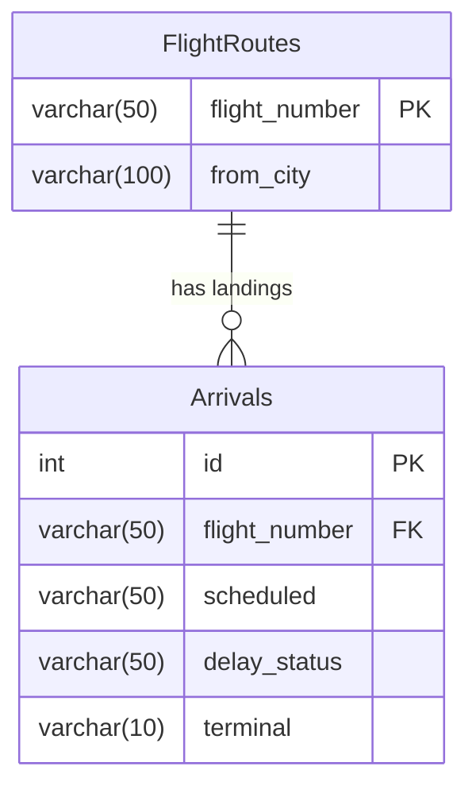

# Flight Arrivals Management System (`JDBC_FlightManager`)

**Course:** Software Engineering Methods (Academic Year 2026–2027)  
**Institution:** Braude College of Engineering | Department of Software Engineering  
**Database Engine:** MySQL 8.0+ | **Language:** Java 25 LTS (JDBC)

---

## 1. Project Description
`JDBC_FlightManager` is the Data Access Layer (DAL) of an airport flight arrivals management system.
The raw landing telemetry file `arrived_flights.csv` (299 records) was imported into MySQL as a flat
table, analyzed for functional dependencies, and decomposed into a Third Normal Form (3NF) schema made
of two tables: `FlightRoutes` (parent) and `Arrivals` (child, linked by a Foreign Key).

On top of this schema, the project implements four JDBC programs, all using `try-with-resources` for
connection hygiene:

| Class | Purpose |
| :--- | :--- |
| `FlightManagerBase` | Smoke test – renders a live arrivals board via `INNER JOIN` of `Arrivals` and `FlightRoutes` (299 rows). |
| `SimpleFlightUpdater` | Updates the `delay_status` of flight `LX354`. Originally written with a concatenated `Statement` (vulnerable), then refactored into a parameterized `PreparedStatement`. |
| `AdvancedFlightDispatcher` | Batch-updates arrivals with IDs 1, 3 and 5 to `"Landed - Final"` using `addBatch()` / `executeBatch()`. |
| `FlightViewer` | Prompts for a terminal (2, 3, 4, 5) and lists its arrivals with a parameterized `INNER JOIN`, sorted by scheduled time. |

The project also demonstrates a live SQL Injection exploit against the vulnerable `Statement` and its
remediation using a `PreparedStatement`.

---

## 2. Engineering Team Details (Single-Workstation Driver–Navigator)

| Role | Full Name | Student ID | Braude Academic Email |
| :--- | :--- | :--- | :--- |
| **Student A** | `[Yair Zaidsher]` | `[206019747]` | `[Yair.Zaidsher@e.braude.ac.il]` |
| **Student B** | `[Dana Weiss]` | `[208103903]` | `[Dana.Weiss@e.braude.ac.il]` |

* **Group Number:** `G[01]`
* **GitHub Repository URL:** `https://github.com/YairZaid/JDBC_FlightManager`

---

## 3. Technology Stack
* **Runtime & JDK:** BellSoft Liberica Full JDK 25 LTS
* **Database Server:** MySQL Server 8.0+ (`FlightDB` schema)
* **JDBC Driver:** MySQL Connector/J 9.5.0 (`mysql-connector-j-9.5.0.jar`)
* **IDE & Database Tooling:** IntelliJ IDEA Ultimate (Built-in Database Console & SQL Generator)
* **Local AI Assistant:** LM Studio (`Qwen2.5-Coder-7B-Instruct`) integrated via the Continue plugin
* **Version Control:** Git & GitHub

---

## 4. Database Normalization (3NF) & Functional Dependencies ($F$)

### 4.1 Functional Dependencies ($F$) in `rawflights`
The flat relation is `rawflights(scheduled, flight, fromC, delay, terminal)`. One row describes one
landing event: a given flight arriving at a given scheduled time. The candidate key is therefore
$\{\text{flight}, \text{scheduled}\}$.

$$F = \{\ \text{flight} \rightarrow \text{fromC},\quad \{\text{flight}, \text{scheduled}\} \rightarrow \{\text{delay}, \text{terminal}\}\ \}$$

* $\text{flight} \rightarrow \text{fromC}$ – a flight number always departs from the same origin city
  (e.g. `LX354` → `Geneva`). The origin depends only on the flight, not on the specific landing.
* $\{\text{flight}, \text{scheduled}\} \rightarrow \{\text{delay}, \text{terminal}\}$ – the delay status
  and the arrival terminal are attributes of one specific landing event.

### 4.2 Why `rawflights` Violated 3NF
`fromC` is a non-key attribute that is determined by `flight` rather than by the whole key. Every landing
is identified by the key, and the key determines `flight`, which in turn determines `fromC`:
$\text{key} \rightarrow \text{flight} \rightarrow \text{fromC}$. This is a transitive dependency of a
non-key attribute on the key. 3NF requires that for every non-trivial FD $X \rightarrow A$, either $X$
is a superkey or $A$ is a prime attribute. In $\text{flight} \rightarrow \text{fromC}$, `flight` is not a
superkey and `fromC` is not prime, so the relation is not in 3NF. The origin city is stored again in
every landing row of the same flight, which causes three anomalies:

* **Update anomaly:** changing a route's origin city requires updating every landing row of that flight.
  Missing one row leaves the database inconsistent (the same flight with two different origins).
* **Insertion anomaly:** a new route (flight number + origin city) cannot be recorded until at least one
  landing of it exists, because `scheduled` is part of the key.
* **Deletion anomaly:** deleting the last landing of a flight also deletes the only record of its origin city.

Decomposing on $\text{flight} \rightarrow \text{fromC}$ stores each route fact exactly once and removes
all three anomalies. The decomposition is lossless, because the shared attribute `flight_number` is the
key of `FlightRoutes`. It is also dependency-preserving.

### 4.3 Decomposed 3NF Relational Schema

**`FlightRoutes`** (parent – one row per route)

| Column | Type | Constraints |
| :--- | :--- | :--- |
| `flight_number` | `VARCHAR(50)` | **Primary Key**, `NOT NULL` |
| `from_city` | `VARCHAR(100)` | `NOT NULL` |

**`Arrivals`** (child – one row per landing event)

| Column | Type | Constraints |
| :--- | :--- | :--- |
| `id` | `INT` | **Primary Key**, `AUTO_INCREMENT` |
| `flight_number` | `VARCHAR(50)` | `NOT NULL`, **Foreign Key** → `FlightRoutes(flight_number)` `ON DELETE CASCADE` (indexed) |
| `scheduled` | `VARCHAR(50)` | |
| `delay_status` | `VARCHAR(50)` | |
| `terminal` | `VARCHAR(10)` | |

The Foreign Key enforces referential integrity: every arrival must reference an existing route.
Because of this dependency, the child table `Arrivals` must be dropped before the parent table `FlightRoutes`.

---

## 5. Independent AI Prompt (Part 4 – `FlightViewer.java`)

```text
Write a Java class named FlightViewer that does the following:
1. Connects to the FlightDB database, prompting the user for the root password via a Scanner using a try-with-resources block.
2. Prompts the user to enter a target terminal number (valid terminals in the dataset are 2, 3, 4, 5).
3. Uses a secure PreparedStatement with '?' to execute a SELECT INNER JOIN between Arrivals and FlightRoutes tables, filtering WHERE Arrivals.terminal = ? and sorting ORDER BY Arrivals.scheduled ASC.
4. Binds the terminal parameter using pstmt.setString(1, terminal) (since terminal is VARCHAR(10)) and prints the formatted query results.
```

---

## 6. Entity Relationship Diagram (ERD)



---

## 7. Security Audit Summary (Part 5 – SQL Injection Mitigation)
* **Attack Payload Tested:** `Landed' #`
* **Vulnerability Analysis (`Statement`):** The original `SimpleFlightUpdater` built its SQL by string
  concatenation:
  ```java
  "UPDATE Arrivals SET delay_status = '" + newStatus + "' WHERE flight_number = '" + FLIGHT_NUMBER + "'"
  ```
  The payload became part of the SQL source code, not a value. Its single quote closed the string literal
  early, and `#` (MySQL's line-comment marker) commented out the rest of the statement:
  ```sql
  UPDATE Arrivals SET delay_status = 'Landed' #' WHERE flight_number = 'LX354'
  ```
  The server executed `UPDATE Arrivals SET delay_status = 'Landed'` with no `WHERE` clause, so all
  299 rows were overwritten instead of only flight `LX354`. The program connects as `root`, so the
  injected SQL ran with full privileges.
* **Remediation (`PreparedStatement`):** The refactored code uses the fixed template
  `UPDATE Arrivals SET delay_status = ? WHERE flight_number = ?`. The template is sent to the server by
  `prepareStatement()` before any user input is involved, so the query's structure is fixed in advance.
  The input is then bound with `pstmt.setString(1, newStatus)` and `pstmt.setString(2, FLIGHT_NUMBER)`
  and transmitted strictly as a data value, never parsed as SQL. Re-running the same payload stored the
  literal text `Landed' #` in the `delay_status` of flight `LX354` only (1 row affected). The quote and
  the `#` were neutralized, and the `WHERE` clause stayed intact.

---

## 8. License
Distributed under the **Braude College Academic License** (Software Engineering Methods, 2026–2027).
